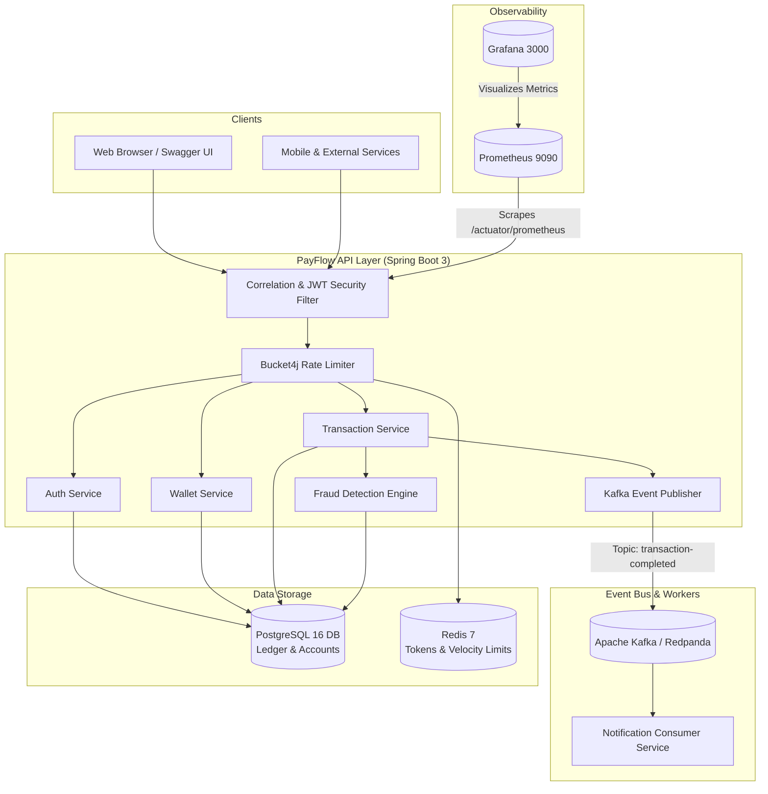

# PayFlow

[](https://openjdk.org/projects/jdk/21/)
[](https://spring.io/projects/spring-boot)
[](https://www.postgresql.org/)
[](https://redpanda.com/)
[](https://redis.io/)
[](https://www.docker.com/)
[](https://prometheus.io/)
[](https://grafana.com/)

A digital wallet and payments engine demonstrating **fintech engineering correctness**, fault tolerance, and high concurrency with production-grade architectural guarantees. Includes a React + TypeScript web app in [`frontend/`](frontend/).

---

## Table of Contents

- [Overview](#overview)
- [System Architecture](#system-architecture)
- [Fintech Engineering Principles](#fintech-engineering-principles)
  - [1. Double-Entry Ledger Bookkeeping](#1-double-entry-ledger-bookkeeping)
  - [2. Strict Request Idempotency](#2-strict-request-idempotency)
  - [3. Optimistic Locking & Concurrency Control](#3-optimistic-locking--concurrency-control)
  - [4. Event-Driven Messaging with Kafka](#4-event-driven-messaging-with-kafka)
  - [5. Real-Time Fraud Detection Engine](#5-real-time-fraud-detection-engine)
  - [6. Token-Bucket Rate Limiting](#6-token-bucket-rate-limiting)
  - [7. Distributed Tracing & Correlation IDs](#7-distributed-tracing--correlation-ids)
- [Database Schema & Migrations](#database-schema--migrations)
- [Infrastructure & Ports](#infrastructure--ports)
- [Quick Start Guide](#quick-start-guide)
- [Live Interactive Demo](#live-interactive-demo)
- [API Reference](#api-reference)
  - [Authentication](#authentication)
  - [Wallets](#wallets)
  - [Transactions](#transactions)
  - [Admin & Fraud](#admin--fraud)
- [Observability & Monitoring](#observability--monitoring)
- [Configuration Reference](#configuration-reference)
- [Project Structure](#project-structure)

---

## Overview

In payments and fintech systems, conventional CRUD patterns with mutable account balances are prone to **race conditions, lost updates, double charges during transient network dropouts, and untraceable financial state**. 

**PayFlow** solves these challenges by treating state transitions as immutable financial events:
- Account balances are **derived from reconciled double-entry ledger entries**, not arbitrary mutable columns.
- Network retries are made **strictly safe through client-supplied idempotency keys**.
- Database triggers and JPA `@Version` annotations prevent race conditions under concurrent load.
- Transaction events stream asynchronously to **Apache Kafka** for decoupled side-effects like notifications.
- All requests are audited with **MDC-backed correlation IDs**, with operational metrics scraped by **Prometheus** and visualized in **Grafana**.

---

## System Architecture



---

## Fintech Engineering Principles

### 1. Double-Entry Ledger Bookkeeping
Balances are **never stored**: a wallet's balance is always `SUM(credits) - SUM(debits)` over its ledger rows, and a transfer is rejected (HTTP 422) if the sender's balance is too low. Top-ups are recorded as transfers from an internal system wallet, so they follow the same rules.

Every transfer writes **exactly one DEBIT row and one CREDIT row** in the `ledger_entries` table inside a single atomic database transaction:
- **Atomicity**: Either both debit and credit succeed, or neither commits.
- **Auditability**: Complete financial provenance for compliance and reconciliation.
- **Database Trigger Enforcement**: PostgreSQL enforces this invariant via the `trg_ledger_double_entry` trigger:
```sql
CREATE TRIGGER trg_ledger_double_entry
BEFORE INSERT ON ledger_entries
FOR EACH ROW EXECUTE FUNCTION enforce_double_entry();
```
If any transaction attempts to write more than one DEBIT or CREDIT for a given transaction ID, the database immediately aborts the insertion.

### 2. Strict Request Idempotency
Clients provide a unique `idempotencyKey` with every transfer request:
- If a mobile client sends a transfer and drops connection before receiving an HTTP 200, it safely retries with the same `idempotencyKey`.
- The system checks `transactionRepository.findByIdempotencyKey(key)`. If found, it refuses duplicate processing and throws an `IdempotencyConflictException` (**HTTP 409 Conflict**), ensuring **zero double-charging**.

### 3. Optimistic Locking & Concurrency Control
Wallets use JPA `@Version` annotations:
```java
@Version
@Column(name = "version", nullable = false)
private Long version = 0L;
```
The sender's wallet is loaded with `LockModeType.OPTIMISTIC_FORCE_INCREMENT`, so every debit bumps its `version` at commit. When two transfers debit the same wallet simultaneously:
- Both read the same balance and version.
- The first transaction commits and increments `version`.
- The second detects the version mismatch at commit, rolls back, and the API returns **HTTP 409** so the client can retry. This prevents overdrawing a wallet without blocking database row-locks.

### 4. Event-Driven Messaging with Kafka
Upon successful ledger commit, the transaction status transitions to `COMPLETED` and `TransactionEventPublisher` publishes a `TransactionCompletedEvent` to the `transaction-completed` Kafka topic. Events are sent from an `afterCommit` hook, so consumers never hear about a transfer that was rolled back.
- A decoupled `@KafkaListener` (`NotificationConsumer`) consumes the event asynchronously.
- Slow third-party systems (SMS, email gateways) never block the critical payment authorization path.

### 5. Real-Time Fraud Detection Engine
Transactions are analyzed against rule sets in `FraudDetectionService`:
- **Large Amount Check**: Transactions exceeding **$10,000** trigger an `AMOUNT_THRESHOLD_EXCEEDED` flag.
- **Velocity Check**: More than **5 transfers** sent from a wallet within a 5-minute sliding window trigger a `VELOCITY_CHECK_FAILED` flag.
- Flagged transactions are persisted in `fraud_flags` and appear in the admin review queue, where an admin can freeze the sender's wallet or mark the flag reviewed.

### 6. Token-Bucket Rate Limiting
Configured using **Bucket4j**:
- Endpoints like `/api/v1/transactions/transfer` are throttled to 10 requests per minute per IP address.
- Excess requests are rejected with **HTTP 429 Too Many Requests**.

### 7. Distributed Tracing & Correlation IDs
`CorrelationFilter` intercepts every incoming HTTP request:
- Reads or generates a unique `X-Correlation-ID` (UUID).
- Stores the ID in SLF4J **MDC** (`Mapped Diagnostic Context`) for structured logging across threads.
- Injects `X-Correlation-ID` into every HTTP response header for distributed tracing.

---

## Database Schema & Migrations

PayFlow manages schema evolution using **Flyway**:

| Migration | Description | Purpose |
|---|---|---|
| **V1** | `Create_users_table.sql` | Stores user credentials (bcrypt hash), role (`USER`, `ADMIN`), and timestamps. |
| **V2** | `Create_wallets_table.sql` | Wallet entity with currency, status (`ACTIVE`, `FROZEN`, `CLOSED`), and `@Version`. |
| **V3** | `Create_transactions_table.sql` | Transaction metadata with unique `idempotency_key`, wallet references, and status. |
| **V4** | `Create_ledger_entries_table.sql` | Double-entry ledger (`DEBIT`/`CREDIT`) with the PostgreSQL double-entry trigger. |
| **V5** | `Create_fraud_flags_table.sql` | Fraud detection audit log linked to transactions. |
| **V6** | `Add_missing_columns.sql` | Schema alignment: adds `currency` to `ledger_entries` and `description` to `fraud_flags`. |
| **V7** | `Ledger_fixes_and_system_wallet.sql` | Tightens the double-entry trigger (at most one DEBIT and one CREDIT per transaction), adds the internal system wallet that funds top-ups, and adds query indexes. |

---

## Infrastructure & Ports

| Service | Port | Description |
|---|---|---|
| **PayFlow API** | `8080` | Spring Boot REST API, Swagger UI, Actuator |
| **PostgreSQL** | `5433` *(host)* &rarr; `5432` *(container)* | Primary relational database (`payflow`/`payflow`) |
| **Redis** | `6379` | Distributed cache & rate limiting store |
| **Kafka (Redpanda)** | `9092` / `9644` | Event streaming cluster & admin console |
| **Prometheus** | `9090` | Time-series metrics collection |
| **Grafana** | `3000` | Operational dashboards (`admin`/`admin`) |

---

## Quick Start Guide

### Prerequisites
- **Java 21+** (OpenJDK or Eclipse Temurin)
- **Maven 3.9+**
- **Docker & Docker Compose**

### 1. Clone & Navigate to Project
```bash
git clone <repository-url>
cd payflow
```

### 2. Start Supporting Infrastructure
Launch PostgreSQL, Redis, Kafka/Redpanda, Prometheus, and Grafana:
```bash
docker compose up -d
```
Verify all containers are healthy:
```bash
docker compose ps
```

### 3. Start the PayFlow Application
```bash
mvn spring-boot:run
```

Once started, the application will be live at:
- **Swagger UI**: [http://localhost:8080/swagger-ui.html](http://localhost:8080/swagger-ui.html)
- **Actuator Health**: [http://localhost:8080/actuator/health](http://localhost:8080/actuator/health)
- **Prometheus Metrics**: [http://localhost:8080/actuator/prometheus](http://localhost:8080/actuator/prometheus)

To create an admin account, start the app with `ADMIN_EMAIL` and `ADMIN_PASSWORD` (12+ characters) set.

### 4. Start the Web App
```bash
cd frontend
cp .env.example .env
npm install
npm run dev
```
Open [http://localhost:5173](http://localhost:5173). The React app has sign-in, a wallet dashboard with top-ups, send money, transaction history with ledger entries, and an admin fraud-review queue. See [`frontend/README.md`](frontend/README.md) for deploying it to Vercel.

---

## Live Interactive Demo

Run this sequence in your terminal to see the complete end-to-end payment workflow in action:

```bash
# 1. Register Alice and save her JWT access token
ALICE_TOKEN=$(curl -s -X POST http://localhost:8080/api/v1/auth/register \
  -H "Content-Type: application/json" \
  -d '{"email":"alice@example.com","password":"password123"}' \
  | grep -o '"accessToken":"[^"]*' | cut -d'"' -f4)
echo "Alice Token: $ALICE_TOKEN"

# 2. Register Bob, then note his wallet ID from GET /wallets/me
BOB_TOKEN=$(curl -s -X POST http://localhost:8080/api/v1/auth/register \
  -H "Content-Type: application/json" \
  -d '{"email":"bob@example.com","password":"password123"}' \
  | grep -o '"accessToken":"[^"]*' | cut -d'"' -f4)
BOB_WALLET=$(curl -s -H "Authorization: Bearer $BOB_TOKEN" http://localhost:8080/api/v1/wallets/me \
  | grep -o '"id":[0-9]*' | cut -d: -f2)

# 3. View Alice's wallet (balance is derived from the ledger)
curl -s -H "Authorization: Bearer $ALICE_TOKEN" http://localhost:8080/api/v1/wallets/me

# 4. Top up Alice's wallet with $1,000 USD (the wallet comes from the JWT)
curl -s -X POST http://localhost:8080/api/v1/wallets/top-up \
  -H "Authorization: Bearer $ALICE_TOKEN" \
  -H "Content-Type: application/json" \
  -d '{"amount": 1000.00}'

# 5. Transfer $250.00 from Alice to Bob
curl -s -X POST http://localhost:8080/api/v1/transactions/transfer \
  -H "Authorization: Bearer $ALICE_TOKEN" \
  -H "Content-Type: application/json" \
  -d "{\"idempotencyKey\":\"demo-txn-001\",\"toWalletId\":$BOB_WALLET,\"amount\":250.00,\"currency\":\"USD\"}"

# 6. Verify Idempotency Protection: Re-send the EXACT SAME request
curl -s -i -X POST http://localhost:8080/api/v1/transactions/transfer \
  -H "Authorization: Bearer $ALICE_TOKEN" \
  -H "Content-Type: application/json" \
  -d "{\"idempotencyKey\":\"demo-txn-001\",\"toWalletId\":$BOB_WALLET,\"amount\":250.00,\"currency\":\"USD\"}"
# -> Returns: HTTP/1.1 409 Conflict: "Duplicate transfer detected for idempotency key: demo-txn-001"

# 7. Query the Double-Entry Ledger directly in PostgreSQL
docker exec payflow-postgres psql -U payflow -d payflow \
  -c "SELECT transaction_id, wallet_id, type, amount, currency FROM ledger_entries;"
```

---

## API Reference

All errors use one JSON shape, so clients can always show `message`:

```json
{ "status": 422, "error": "Unprocessable Entity", "message": "Insufficient balance: available 40.00 USD",
  "path": "/api/v1/transactions/transfer", "timestamp": 1763452800000 }
```

| Status | When |
|---|---|
| 400 | Validation failed or malformed JSON |
| 401 | Missing, invalid or expired access token; wrong email/password |
| 403 | Authenticated but not allowed (e.g. non-admin calling `/admin/**`) |
| 404 | Wallet, transaction or flag not found (or not yours) |
| 409 | Duplicate idempotency key, email already registered, or concurrent update of the same wallet (safe to retry with a new key) |
| 422 | Business rule broken: insufficient balance, frozen wallet, sending to yourself, currency mismatch |
| 429 | More than 10 transfers per minute from one client |

### Authentication

#### `POST /api/v1/auth/register`
Creates a `USER` account and a default active USD wallet. Public sign-up can never create an admin.
```json
// Request
{ "email": "user@example.com", "password": "securePassword123" }

// Response (201 Created) — same shape for login and refresh
{
  "accessToken": "eyJhbGciOiJIUzUxMiJ9...",
  "refreshToken": "eyJhbGciOiJIUzUxMiJ9...",
  "tokenType": "Bearer",
  "userId": 2,
  "email": "user@example.com",
  "role": "USER"
}
```

#### `POST /api/v1/auth/login`
```json
// Request
{ "email": "user@example.com", "password": "securePassword123" }
// Response (200 OK): same as register
```

#### `POST /api/v1/auth/refresh`
Swaps a refresh token (valid 7 days) for a new access token (valid 15 minutes) and refresh token. Refresh tokens cannot be used as access tokens.
```json
// Request
{ "refreshToken": "eyJhbGciOiJIUzUxMiJ9..." }
// Response (200 OK): same as register
```

### Wallets

#### `GET /api/v1/wallets/me`
```json
// Response (200 OK)
{
  "id": 2, "userId": 2, "currency": "USD", "status": "ACTIVE",
  "balance": 750.0000, "version": 3, "createdAt": "2026-11-18T08:30:00Z"
}
```
`balance` is never stored. It is computed from the ledger as `SUM(credits) - SUM(debits)`.

#### `POST /api/v1/wallets/top-up`
Adds money to **your own** wallet (taken from the JWT). Recorded as a double-entry transfer from an internal system wallet. Max 10,000 per top-up.
```json
// Request (idempotencyKey optional)
{ "amount": 500.00, "idempotencyKey": "topup-3f9c..." }
// Response (200 OK): the updated wallet, same shape as GET /wallets/me
```

### Transactions

#### `POST /api/v1/transactions/transfer`
Atomic double-entry transfer from **your own** wallet. `fromWalletId` is optional; if sent it must be your wallet.
```json
// Request
{ "idempotencyKey": "order-uuid-9843", "toWalletId": 3, "amount": 150.00, "currency": "USD" }

// Response (201 Created)
{ "transactionId": 7, "idempotencyKey": "order-uuid-9843", "status": "COMPLETED" }
```

#### `GET /api/v1/transactions/history?page=0&size=10&from=…&to=…`
Your transactions, newest first. `from`/`to` are optional ISO-8601 instants (e.g. `2026-11-01T00:00:00Z`).
```json
// Response (200 OK) — a Spring Page
{
  "content": [
    {
      "id": 7, "idempotencyKey": "order-uuid-9843", "kind": "TRANSFER",
      "fromWallet": 2, "toWallet": 3, "amount": 150.0000, "currency": "USD",
      "status": "COMPLETED", "failureReason": null, "underReview": false,
      "createdAt": "2026-11-18T08:41:00Z"
    }
  ],
  "totalElements": 12, "totalPages": 2, "number": 0, "size": 10, "first": true, "last": false
}
```
`kind` is `TRANSFER` or `TOP_UP`. `underReview` is true while the transaction has an unreviewed fraud flag.

#### `GET /api/v1/transactions/{id}`
One of your transactions (admins can see any), including its ledger rows:
```json
{
  "id": 7, "kind": "TRANSFER", "fromWallet": 2, "toWallet": 3, "amount": 150.0000, "...": "...",
  "ledgerEntries": [
    { "walletId": 2, "type": "DEBIT",  "amount": 150.0000, "currency": "USD" },
    { "walletId": 3, "type": "CREDIT", "amount": 150.0000, "currency": "USD" }
  ]
}
```

### Admin & Fraud

*All admin endpoints require `ROLE_ADMIN`. The admin account is created on startup from `ADMIN_EMAIL` / `ADMIN_PASSWORD`.*

- `GET /api/v1/admin/users`: Lists registered users and roles.
- `GET /api/v1/admin/wallets/{walletId}`: Inspects any wallet (same shape as `/wallets/me`).
- `POST /api/v1/admin/wallets/{walletId}/freeze`: Blocks the wallet from sending or receiving.
- `POST /api/v1/admin/wallets/{walletId}/unfreeze`: Restores the wallet to `ACTIVE`.
- `GET /api/v1/admin/fraud/flags`: Unreviewed fraud flags, newest first:
  ```json
  [{
    "id": 4, "rule": "AMOUNT_THRESHOLD_EXCEEDED", "description": "Amount 12000 is above the 10000 limit",
    "reviewed": false, "createdAt": "2026-11-18T09:02:00Z",
    "transactionId": 9, "fromWalletId": 2, "toWalletId": 3, "amount": 12000.0000, "currency": "USD",
    "fromWalletStatus": "ACTIVE", "fromUserEmail": "alice@example.com"
  }]
  ```
- `POST /api/v1/admin/fraud/flags/{id}/review?reviewed=true`: Marks a flag as reviewed; returns the updated flag.

---

## Observability & Monitoring

### 1. Swagger UI
Interactive OpenAPI 3.0 documentation:
👉 [http://localhost:8080/swagger-ui.html](http://localhost:8080/swagger-ui.html)

### 2. Prometheus
Scrapes metrics exposed by Spring Boot Actuator:
👉 [http://localhost:9090](http://localhost:9090)
Useful metrics:
- `http_server_requests_seconds_count`
- `jvm_memory_used_bytes`
- `hikaricp_connections_active`

### 3. Grafana
Pre-configured monitoring interface:
👉 [http://localhost:3000](http://localhost:3000) *(User: `admin`, Password: `admin`)*

---

## Configuration Reference

Key configuration options defined in `src/main/resources/application.yml` and overridable via environment variables:

| Environment Variable | Default Value | Description |
|---|---|---|
| `PORT` | `8080` | Port for the Spring Boot application |
| `DB_HOST` | `localhost` | PostgreSQL host |
| `DB_PORT` | `5433` | PostgreSQL port |
| `DB_NAME` | `payflow` | Database name |
| `DB_USER` | `payflow` | Database username |
| `DB_PASSWORD` | `payflow` | Database password |
| `REDIS_HOST` | `localhost` | Redis host |
| `REDIS_PORT` | `6379` | Redis port |
| `KAFKA_SERVERS` | `localhost:9092` | Kafka bootstrap brokers |
| `KAFKA_ENABLED` | `true` | Set `false` on hosts without a broker; events are then skipped |
| `KAFKA_AUTO_STARTUP` | `true` | Set `false` to stop the notification consumer from connecting |
| `JWT_SECRET` | *dev-only default* | Secret for signing JWTs (at least 32 characters). **Always set in production** |
| `CORS_ALLOWED_ORIGINS` | `http://localhost:5173` | Comma-separated browser origins allowed to call the API (patterns like `https://*.vercel.app` work) |
| `ADMIN_EMAIL` | *(empty)* | Admin account created on startup |
| `ADMIN_PASSWORD` | *(empty)* | Admin password (at least 12 characters) |
| `FRAUD_MAX_AMOUNT` | `10000.00` | Threshold amount for triggering fraud flag |
| `FRAUD_VELOCITY_COUNT` | `5` | Maximum transfers allowed in the 5-minute velocity window |

---

## Project Structure

```
payflow/
├── src/
│   ├── main/
│   │   ├── java/com/payflow/
│   │   │   ├── admin/             # Admin user management controller and DTOs
│   │   │   ├── config/            # OpenAPI/Swagger and Web servlet filter registration
│   │   │   ├── exception/         # Domain exceptions and @RestControllerAdvice handler
│   │   │   ├── fraud/             # Fraud rules engine, flag entity, and admin review API
│   │   │   ├── notification/      # Asynchronous Kafka notification consumer
│   │   │   ├── rate/              # Bucket4j token-bucket rate limiting filter & service
│   │   │   ├── security/          # JWT filter, utility, UserPrincipal, and SecurityConfig
│   │   │   ├── transaction/       # Core transfer engine, double-entry ledger, Kafka publisher
│   │   │   ├── user/              # User entity, repository, and auth service
│   │   │   ├── wallet/            # Wallet entity, repository, and balance management
│   │   │   ├── walletconfig/      # Admin wallet freeze/unfreeze endpoints
│   │   │   └── PayFlowApplication.java
│   │   └── resources/
│   │       ├── db/migration/      # Flyway SQL migrations (V1 through V7)
│   │       ├── application.yml    # Main configuration
│   │       └── application-test.yml
├── frontend/                      # React + TypeScript web app (Vite)
├── docker-compose.yml             # Postgres, Redis, Redpanda, Prometheus, Grafana
├── prometheus.yml                 # Prometheus scrape configuration
├── pom.xml                        # Maven dependencies and compiler plugins
└── README.md
```

---

## License

This project is open-source and available under the [MIT License](LICENSE).
